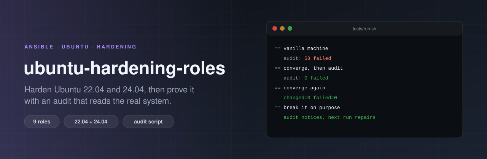

<p align="center">
  
</p>

# ubuntu-hardening-roles

[](https://github.com/ErenOzgu/ubuntu-hardening-roles/actions/workflows/ci.yml)
[](LICENSE)

Nine small Ansible roles that harden an Ubuntu 22.04 or 24.04 server, and a read-only audit script that checks the result from the outside.

The list of settings is the boring part: any hardening guide has one. What this repository adds is the proof. CI converges a real GitHub-hosted machine (not a container), audits it, converges again to check that nothing changes, and then **breaks things on purpose** (turns root login back on, deletes the firewall table, reinstalls telnet, clears the audit rules...) to check that the audit notices each one and the next playbook run repairs it.

```sh
git clone https://github.com/ErenOzgu/ubuntu-hardening-roles && cd ubuntu-hardening-roles

ansible-playbook -i 'your-host,' site.yml                  # a remote machine
ansible-playbook -i 'localhost,' -c local site.yml -K      # the machine you are on

sudo audit/hardening-audit.sh                              # then check it
```

Only `ansible.builtin` modules are used, so there is nothing to install from Galaxy. Needs ansible-core 2.15 or newer on the control machine and Python 3 with `python3-apt` on the target (a stock Ubuntu has both).

**Try it on a test machine first.** These roles change how you can log in and which ports answer. Read "Before you run it" below.

## What it does

| Role | What it does | Audit group |
|---|---|---|
| `ssh` | Installs a drop-in `/etc/ssh/sshd_config.d/00-hardening.conf`: no root login, no passwords, modern ciphers/MACs/key exchange, `MaxAuthTries 3`, no forwarding, a banner. Checked with `sshd -t` before it is written. | `ssh` |
| `sysctl` | 33 kernel and network settings in `/etc/sysctl.d/60-hardening.conf` (reverse-path filter, no redirects or source routing, SYN cookies, restricted `dmesg` and kernel pointers, protected links, BPF hardening...). | `sysctl` |
| `firewall` | Inbound default-drop in a dedicated nftables table, `inet hardening`, loaded by its own systemd unit. SSH is rate limited; extra ports are a variable. Other tables (Docker, ufw) are left alone. | `fw` |
| `accounts` | `login.defs` password ageing and `umask 027`, `pwquality` (14 characters, 3 classes), core dumps off. | `acct` |
| `permissions` | Owner and mode of cron, `sshd_config`, `passwd`, `shadow` and `group` files. | `perm` |
| `auditd` | Installs auditd and a small, readable rule set: account files, sudoers, sshd config, clock changes, kernel module loading, mounts. | `audit` |
| `updates` | Daily package list refresh and unattended security upgrades. No automatic reboot unless you ask for one. | `upd` |
| `kernel_modules` | `install ... /bin/false` for cramfs, freevxfs, hfs, hfsplus, jffs2, dccp, sctp, rds and tipc. | `mod` |
| `services` | Purges telnet, rsh and friends. Disables Avahi, CUPS, NFS, SNMP and other services if they exist. | `svc` |

## Before you run it

- **SSH lockout guard.** Password logins are switched off, so if nobody on the machine has a non-empty `authorized_keys` file the `ssh` role stops with an error before anything else is changed. `ssh` runs first in `site.yml` for exactly this reason. `-e '{"ssh_lockout_guard": false}'` overrides it.
- **The firewall is inbound only.** SSH (port `firewall_ssh_port`, 22 by default) is open and rate limited; everything else inbound is dropped except replies, loopback, ICMP, DHCP and IPv6 neighbour discovery. Add what you serve: `-e '{"firewall_tcp_ports": [80, 443]}'`.
- **`net.ipv4.ip_forward` is not touched.** A Docker or Kubernetes host needs it on; a plain server probably wants it off. Put your choice in `sysctl_overrides`.
- **Existing users keep their old password ageing.** `login.defs` only affects accounts created afterwards. Use `chage` on the others.
- **The services list is a list of things most servers do not run.** If you do run one of them, take it out of `services_disable` first.

## Variables

Every role has a `defaults/main.yml` with the values it uses. The ones you are most likely to change:

| Variable | Default | |
|---|---|---|
| `ssh_password_authentication` | `false` | |
| `ssh_allow_users` / `ssh_allow_groups` | `[]` | empty means no restriction |
| `ssh_lockout_guard` | `true` | |
| `firewall_tcp_ports` / `firewall_udp_ports` | `[]` | open in addition to SSH |
| `firewall_ssh_rate` | `10/minute` | new SSH connections per source |
| `sysctl_overrides` | `{}` | merged over `sysctl_settings` |
| `accounts_pwquality_minlen` | `14` | |
| `updates_automatic_reboot` | `false` | |
| `kernel_modules_disabled` | see file | add `udf` or `usb-storage` if you do not use them |
| `services_disable` | see file | |

```yaml
- hosts: web
  become: true
  vars:
    firewall_tcp_ports: [80, 443]
    ssh_allow_groups: [admins]
    sysctl_overrides:
      net.ipv4.ip_forward: 1
  roles: [ssh, sysctl, firewall, accounts, permissions, auditd, updates, kernel_modules, services]
```

## The audit script

`audit/hardening-audit.sh` is a single bash file with no dependencies. It reads the state the machine is actually in (`sshd -T`, `sysctl -n`, `nft list`, `dpkg`, `systemctl`, `auditctl -l`, `modprobe -n -v`...) and **never reads the Ansible variables**, so it is an independent check: it works on a host hardened some other way, and it notices drift after the playbook has been run.

```
$ sudo audit/hardening-audit.sh --only acct        # on a machine nobody has hardened yet
FAIL  acct-pass-max-days        passwords expire within 365 days  [found '99999', want <= 365]
FAIL  acct-pass-min-days        passwords cannot be changed more than once a day  [found '0', want >= 1]
FAIL  acct-umask                the default umask is 027 or stricter  [found '022']
FAIL  acct-pwquality-minlen     passwords need at least 14 characters  [found '<unset>', want >= 14]
...
PASS  acct-no-empty-passwords   no account has an empty password
PASS  acct-single-uid0          root is the only account with UID 0
```

Options: `--json` for machine-readable output, `--only ssh,sysctl,fw,acct,perm,audit,upd,mod,svc` to pick groups. Exit status is 0 when nothing failed, 1 when a check failed, 2 for bad usage or when not run as root. There are about 110 checks (the exact number depends on the machine: checks that do not apply are still listed, as `SKIP`). A check that does not apply (for example a sysctl key the kernel does not have) is reported as `SKIP`, not as a pass.

Its one side effect: it creates an empty `/run/sshd` if missing, because `sshd -T` refuses to run without it.

## How it is tested

`tests/run.sh` does the following on a real Ubuntu machine, and CI runs it on `ubuntu-22.04` and `ubuntu-24.04`:

1. **The audit is not vacuous.** On the untouched runner it must fail at least 10 checks.
2. **The lockout guard works.** Without authorized keys the playbook must refuse, and `sshd` must not have been reconfigured yet.
3. **Converge, then audit.** Zero failed checks.
4. **Idempotence.** A second run reports `changed=0`.
5. **Drift.** Nine mutations, each followed by "the audit must report this exact check as failed", a converge, and "the audit is clean again":

   | Break | Check that must fail |
   |---|---|
   | `PermitRootLogin yes` in the drop-in | `ssh-permitrootlogin` |
   | `sysctl -w net.ipv4.tcp_syncookies=0` | `sysctl-net.ipv4.tcp_syncookies` |
   | `nft delete table inet hardening` | `fw-table` |
   | `chmod 666 /etc/group` | `perm-group` |
   | `PASS_MAX_DAYS 99999` in `login.defs` | `acct-pass-max-days` |
   | `apt-get install telnet` | `svc-pkg-telnet` |
   | delete the modprobe file | `mod-cramfs` |
   | `auditctl -D` | `audit-rules-identity` |
   | set the daily unattended-upgrade switch to `"0"` | `upd-unattended` |

6. **The machine still works.** `sshd -t` passes and the firewall table is loaded.

Real machines rather than Docker, because half of what these roles do (sysctl, nftables, auditd, systemd units, sshd) does not exist inside a container. The cost is that `tests/run.sh` really hardens the machine it runs on, so it belongs on a throwaway VM.

Separately, CI runs `yamllint`, `ansible-lint` on the `production` profile, `shellcheck` and `ansible-playbook --syntax-check`.

## Design notes

- **Drop-ins, not edits.** sshd, sysctl, modprobe, apt and audit settings are separate files that this repository owns completely, so the stock config files stay as the distribution shipped them. The sshd drop-in is named `00-hardening.conf` because sshd keeps the *first* value it sees, and cloud images ship `50-cloud-init.conf` with `PasswordAuthentication yes`.
- **A table of its own.** The firewall role only creates and replaces `table inet hardening`. A packet must be accepted by every input chain, so this table can only make the host stricter, and it never flushes anybody else's rules.
- **Live values are re-applied.** The handler for a changed file is the usual way, but it would miss somebody running `sysctl -w` or `auditctl -D` by hand. The `sysctl` and `auditd` roles therefore check the live state on every run. Re-applying equal values is a no-op and does not count as a change.
- **Validate before reload.** Files that can lock you out (sshd, nftables) are validated with the tool's own syntax check before they are written.
- **Boolean variables go through `| bool`,** so `-e some_flag=false` on the command line does what it looks like it does.

## What this is not

- **Not a CIS or STIG certification.** It covers a sensible slice of what those documents ask for, and the audit checks exactly that slice.
- **Not an upgrade tool.** It does not do `do-release-upgrade`, and it was not tested on 18.04, 20.04 or anything that is not 22.04 or 24.04.
- **Not complete.** Not covered: partitioning and mount options (`/tmp`, `/var`, `/home`), boot loader passwords, AppArmor profile management, wiring `pam_faillock` into the PAM stack (it is easy to lock yourself out, so it is left to you), time synchronisation, log shipping, desktop systems.
- **Not a replacement for knowing your machine.** The firewall and services defaults assume a server that runs SSH and whatever you add.

## License

MIT, see [LICENSE](LICENSE).
